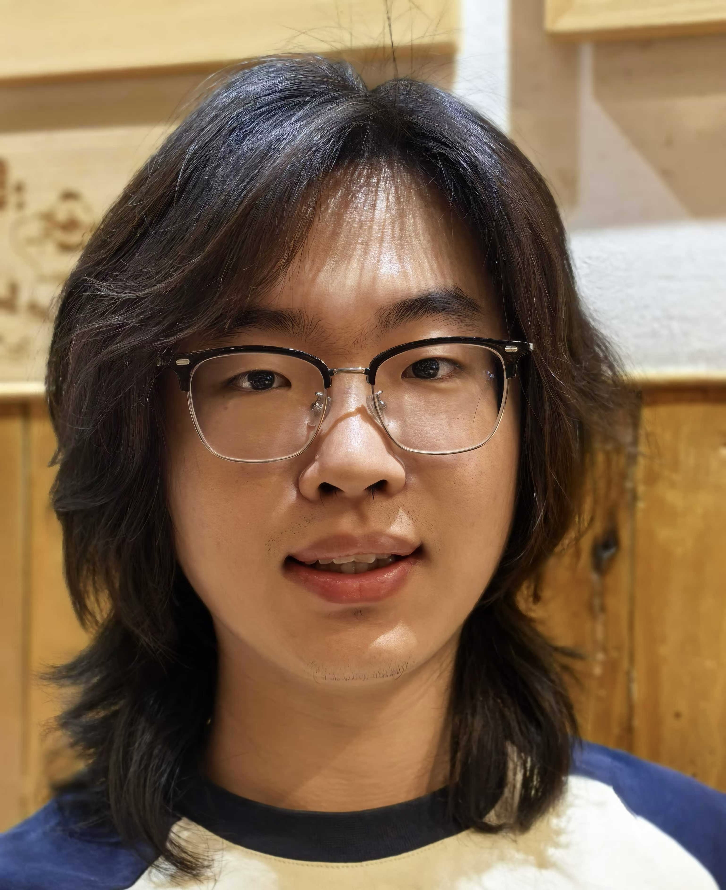

## About Me

  

Hello, I'm Bowen Liu, a PhD student at the Yau Mathematical Sciences Center of Tsinghua University. I have been supervised by [Chenglong Yu](https://chenglongyu.github.io/) since September 2022, and by Mao Sheng since 2025.

My research interests focus on vector bundles and Higgs bundles, including non-abelian Hodge theory and stability conditions. Recently, I have been studying bundles over abelian varieties.

My email is liubw22 [at] mails [dot] tsinghua [dot] edu [dot] cn, and you can find me at S103 in C740 of Shuangqing Complex Building A. 

Please contact me by email, or let's have coffee at Shuangqing, if you find any mistakes in my notes. All comments are welcome.

### Archived

* [Notes](/notes.md) - Seminar notes, lecture notes, and some learning notes I typed when I was learning it.
* [Research](/preprints.md) - Preprints.
* [Teaching](/teaching.md) - Courses I taught or as a teaching assistant.
* [Travel](/travel.md) - Workshops and summer schools I've attended.
